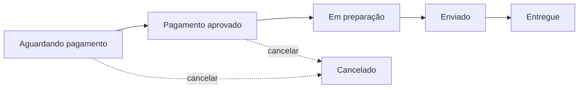

<div align="center">

# ⚡ KamiStore

### Marketplace de tecnologia: hardware, periféricos e muito mais, de vendedores de todo o Brasil.

Frontend em **Angular** de um e-commerce completo no estilo dos grandes marketplaces,<br/>
com vitrine, carrinho, checkout, painel do vendedor e painel administrativo.

<br/>


[Funcionalidades](#-funcionalidades) •
[Tecnologias](#-tecnologias) •
[Como rodar](#-como-rodar) •
[Estrutura](#️-estrutura-do-projeto) •
[Rotas](#-rotas) •
[API](#-integração-com-a-api)

</div>

---

## ✨ Funcionalidades

<table>
<tr>
<td width="50%" valign="top">

### 🛍️ Para quem compra
- Vitrine com **categorias**, lançamentos e menores preços
- **Busca** por nome com ordenação e paginação
- Página do produto com **galeria de fotos**
- Escolha de **cor e tamanho**, com preço e estoque por variação
- **Carrinho** salvo na conta
- **Checkout** com escolha ou cadastro de endereço
- **Acompanhamento do pedido** em linha do tempo
- Cancelamento antes da preparação
- **Avaliações** com estrelas para produtos entregues

</td>
<td width="50%" valign="top">

### 🏪 Para quem vende
- Cadastro de loja com **CNPJ**
- Painel com **pedidos, pendências e faturamento**
- Cadastro e edição de produtos
- **Upload de várias fotos** (até 10 por produto)
- **Editor de variações** com geração automática da grade cor × tamanho
- Pausar ou ativar anúncios
- Avanço do status das vendas: pagamento → preparação → envio → entrega
- Página pública da loja

</td>
</tr>
<tr>
<td width="50%" valign="top">

### 🛡️ Para o administrador
- Visão geral: pedidos, clientes, vendedores, produtos e volume vendido
- Gestão de **status de qualquer pedido**
- **Moderação** de produtos e avaliações
- Listagem de usuários, clientes e vendedores
- Exclusão de usuários

</td>
<td width="50%" valign="top">

### 🎨 Experiência
- Layout **responsivo**, do celular ao desktop
- Estados de carregamento (*skeletons*), vazio e erro
- Notificações (*toasts*) de sucesso e erro
- Máscaras de CPF, CNPJ e CEP
- Validação dos formulários com as **mesmas regras da API**
- Sessão com expiração automática do token
- Arte gerada por categoria para produtos sem foto

</td>
</tr>
</table>

---

## 🧰 Tecnologias

| Camada | Escolha |
|---|---|
| Framework | **Angular 22**: standalone components, *zoneless*, nova sintaxe de controle (`@if`, `@for`, `@switch`) |
| Estado | **Signals** (`signal`, `computed`, `effect`) e `httpResource` para leituras |
| Formulários | **Reactive Forms** tipados, com `FormArray` para as variações |
| HTTP | `HttpClient` com **interceptor funcional** que injeta o JWT e trata 401 |
| Rotas | *Lazy loading* em todas as páginas, **guards** por perfil e *input binding* de parâmetros |
| Estilo | **SCSS** com *design tokens* em CSS variables e sem biblioteca de UI |
| Ícones | SVG inline no estilo *Lucide* |
| Localização | `pt-BR`, moeda **BRL** |

---

## 🚀 Como rodar

### Pré-requisitos
- [Node.js](https://nodejs.org/) **20+**
- A **API do backend** (Spring Boot) rodando em `http://localhost:8080`

### Passo a passo

```bash
# 1. Clone o repositório
git clone https://github.com/PominiGa/KamiStore.git
cd KamiStore

# 2. Instale as dependências
npm install

# 3. Suba o servidor de desenvolvimento
npm start
```

Acesse **http://localhost:4200** 🎉

> [!TIP]
> As chamadas para `/api/**` são repassadas para `http://localhost:8080` pelo [`proxy.conf.json`](proxy.conf.json). Por isso o backend não precisa de configuração de CORS em desenvolvimento.

### Scripts

| Comando | O que faz |
|---|---|
| `npm start` | Servidor de desenvolvimento com *hot reload* |
| `npm run build` | Build de produção em `dist/kamistore/browser` |
| `npm run watch` | Build contínuo em modo desenvolvimento |

---

## 🗂️ Estrutura do projeto

```
src/app
├── core/                     # Regras e integração com a API
│   ├── models.ts             # Tipos espelhando os DTOs do backend
│   ├── api.ts                # Base da API, paginação e tratamento de erros
│   ├── auth.service.ts       # Login, sessão JWT e perfil do usuário
│   ├── auth.interceptor.ts   # Injeta "Authorization: Bearer" e trata 401
│   ├── guards.ts             # authGuard, roleGuard('CLIENTE' | 'VENDEDOR' | 'ADMIN')
│   ├── carrinho.service.ts   # Estado global do carrinho (signals)
│   ├── services.ts           # Produtos, pedidos, avaliações, conta e admin
│   └── pedido-status.ts      # Fluxo e rótulos de status
│
├── shared/                   # Componentes reutilizáveis
│   ├── header / footer / toasts
│   ├── produto-card, produto-img, estrelas, paginacao
│   ├── endereco-campos, pedido-card, status-badge, estado
│   └── icon, mascaras, categorias
│
└── pages/                    # Telas (todas com lazy loading)
    ├── home, busca, produto, loja
    ├── auth/                 # login e cadastro (cliente ou vendedor)
    ├── carrinho, checkout, pedido
    ├── conta/                # dados, endereços, telefones e pedidos
    ├── vendedor/             # produtos, formulário e vendas
    └── admin/
```

---

## 🧭 Rotas

| Rota | Acesso | Descrição |
|---|:---:|---|
| `/` | Público | Página inicial |
| `/busca?q=&ordem=&pagina=` | Público | Busca e listagem de produtos |
| `/produto/:id` | Público | Detalhe, fotos, variações e avaliações |
| `/loja/:id` | Público | Produtos de um vendedor |
| `/login` · `/cadastro` | Visitante | Entrar e criar conta |
| `/carrinho` · `/checkout` | 🛍️ Cliente | Carrinho e finalização da compra |
| `/conta/pedidos` | 🛍️ Cliente | Histórico de pedidos |
| `/pedido/:id` | Logado | Detalhe e linha do tempo do pedido |
| `/conta` | Logado | Dados, endereços e telefones |
| `/vendedor/**` | 🏪 Vendedor | Painel do vendedor |
| `/admin` | 🛡️ Admin | Painel administrativo |

---

## 🔌 Integração com a API

O frontend consome uma API REST em **Spring Boot** com autenticação **JWT** e três perfis: `CLIENTE`, `VENDEDOR` e `ADMIN`.

<details>
<summary><b>Ver endpoints utilizados</b></summary>

<br/>

| Recurso | Endpoints |
|---|---|
| Autenticação | `POST /api/usuario/login` · `GET/PUT /api/usuario/me` |
| Cadastro | `POST /api/clientes` · `POST /api/vendedores` |
| Endereços e telefones | `/api/usuario/me/enderecos` · `/api/usuario/me/telefones` |
| Produtos | `GET /api/produtos` · `GET /api/produtos/{id}` · `GET /api/produtos/vendedor/{id}` · `POST/PUT /api/produtos` · `PATCH /api/produtos/{id}/status` |
| Fotos | `POST /api/produtos/{id}/imagens` (multipart) · `GET/DELETE /api/produtos/{id}/imagens/{imagemId}` |
| Carrinho | `GET/DELETE /api/carrinho` · `POST /api/carrinho/itens` · `PUT/DELETE /api/carrinho/itens/{produtoId}?variacaoId=` |
| Pedidos | `POST /api/pedidos` · `GET /api/pedidos/meus` · `GET /api/pedidos/vendas` · `GET /api/pedidos/{id}` · `POST /api/pedidos/{id}/cancelar` · `PATCH /api/pedidos/{id}/status` |
| Avaliações | `GET /api/produtos/{id}/avaliacoes` · `GET .../resumo` · `POST .../avaliacoes` · `DELETE /api/avaliacoes/{id}` |
| Admin | `GET /api/usuario` · `DELETE /api/usuario?email=` · `GET /api/clientes` · `GET /api/vendedores` · `GET /api/pedidos` |

</details>

### Fluxo do pedido



O cliente pode cancelar até o pagamento ser aprovado, e os itens voltam ao estoque. Os erros da API (`{ "mensagem": "...", "campos": { ... } }`) são exibidos diretamente ao usuário, em português.

---

<div align="center">

Feito com ☕ e Angular

</div>
